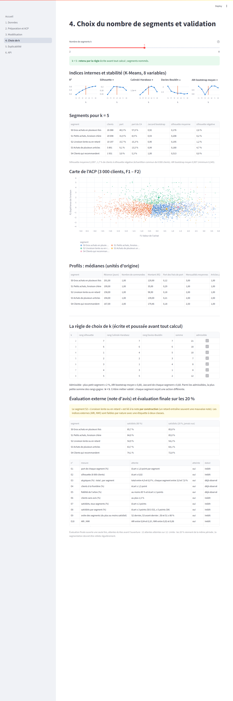
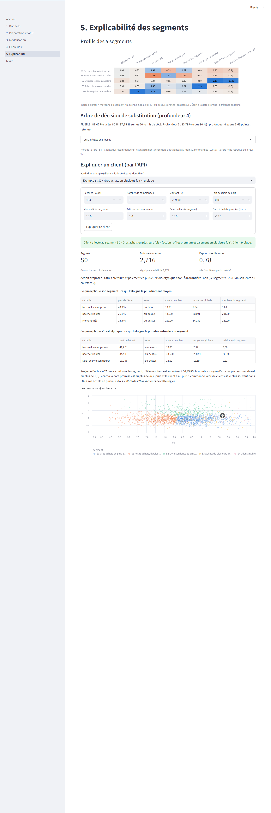
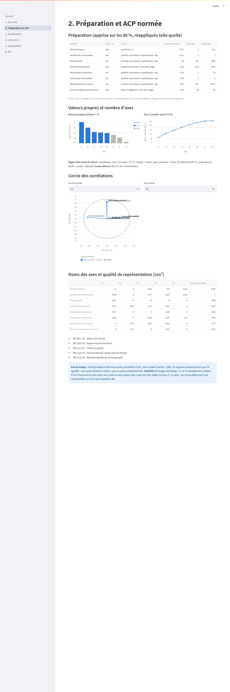
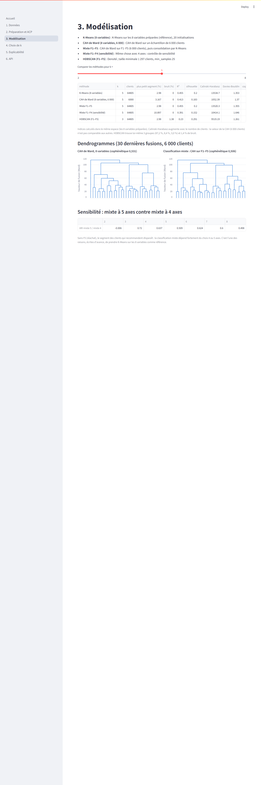
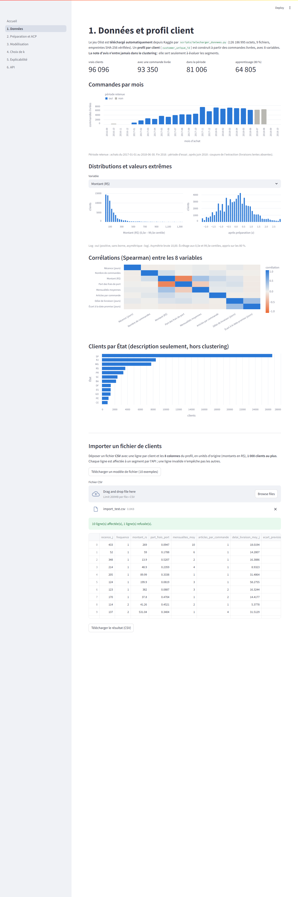

# Segmentation explicable des clients Olist

Application web interactive de **segmentation client explicable** : un profil par client, une
ACP pour le résumer, plusieurs algorithmes de clustering comparés, un nombre de segments choisi
par une règle écrite à l'avance, des segments nommés, expliqués et associés à une action, et une
**API** qui affecte et explique un nouveau client.

Projet Challenge 3 (Data Mining, ENSI, filière II3-IF).

- **API (FastAPI)** : https://segmentation-xai-api.onrender.com — documentation interactive :
  [`/docs`](https://segmentation-xai-api.onrender.com/docs)
- **Application (Streamlit)** : lien ajouté après le déploiement.
- **Synthèse (2 pages)** : [reports/synthese.pdf](reports/synthese.pdf)
- **Journal de tous les choix** : [docs/CHOIX.md](docs/CHOIX.md)

> Sur l'offre gratuite de Render, l'API s'endort après 15 minutes sans requête : le premier
> appel suivant prend environ 30 à 60 secondes.

## Données

- **Source** : *Brazilian E-Commerce Public Dataset by Olist*, sur Kaggle :
  https://www.kaggle.com/datasets/olistbr/brazilian-ecommerce
- **Données réelles et anonymisées** (page Kaggle : « This is real commercial data, it has been
  anonymised »), environ 100 000 commandes de 2016 à 2018. Montants en **réals brésiliens (R$)**.
- **Licence des données : CC BY-NC-SA 4.0** (attribution, pas d'usage commercial, partage dans
  les mêmes conditions).
- Remerciement repris de la page du jeu : **« Thanks to Olist for releasing this dataset. »**
- **Aucune donnée brute n'est dans ce dépôt** : `scripts/telecharger_donnees.py` télécharge le jeu
  depuis Kaggle **sans compte ni jeton** et vérifie ses empreintes SHA-256. Les seules données
  versionnées sont **dérivées** (agrégats par client, sans aucun identifiant) : `data/demo/` (10 clients d'exemple) et `app/donnees/`
  (fichiers précalculés de l'application), sous **CC BY-NC-SA 4.0**.

## Licence

- **Code : licence MIT** (fichier [LICENSE](LICENSE)), © 2026 Mohamed Aljene.
- **Données dérivées (`data/demo/`, `app/donnees/`) : CC BY-NC-SA 4.0**, donc **sans usage
  commercial**, même si le code, lui, est sous MIT.

## Méthode en bref

1. **Données et profil client** — commandes livrées achetées du 2017-01-01 au 2018-06-30 (fin de
   2016 : période d'essai ; après juin 2018 : coupure de l'extraction, les livraisons lentes y
   manquent). Un profil par vrai client (`customer_unique_id`) avec 8 variables : Récence,
   Fréquence, Montant (prix des articles), part des frais de port, mensualités moyennes, articles
   par commande, délai de livraison moyen, écart à la date promise. **La note d'avis n'entre jamais
   dans le clustering** : elle sert seulement à évaluer les segments. 20 % des clients sont mis de
   côté dès le départ.
2. **Préparation et ACP** — apprises sur les 80 % : `log(1 + x)` des variables positives
   asymétriques, écrêtage aux 0,5e et 99,5e centiles, standardisation ; ACP normée, 5 axes retenus
   par la règle max(Kaiser, part cumulée ≥ 70 %).
3. **Modélisation** — K-Means sur les 8 variables (méthode de référence), CAH de Ward, classification
   mixte (CAH sur les axes de l'ACP puis consolidation par K-Means), HDBSCAN.
4. **Choix de k** — indices internes, stabilité par bootstrap (ARI, Jaccard), puis critère métier.
5. **Explicabilité** — profils, arbre de décision de substitution traduit en phrases, explication de
   chaque client (distance, variables qui l'éloignent, indicateurs « atypique » et « à la
   frontière »).
6. **API** — chaîne figée lue dans des fichiers JSON, sans scikit-learn.

**Les choix principaux ont été écrits et poussés avant le calcul** (règles de préparation, de
l'ACP, du choix de k, de la note d'avis, de l'explicabilité, attentes de l'évaluation finale).
Les exceptions sont tracées honnêtement dans le [journal](docs/CHOIX.md), par exemple :

- le critère de lecture de l'hypothèse sur S3 (écart « net » si au moins 10 points) a été fixé dans
  le script avant le calcul, mais sans accord préalable ;
- la taille de l'échantillon de la CAH a été corrigée après mesure de la mémoire (estimation
  fausse, 12 × n² octets au lieu de 28 × n²), avant tout calcul de partition ;
- l'estimation du temps de calcul de l'étape 5 était fausse d'un facteur 9 (45 minutes) ;
- la silhouette détaillée a été ajoutée après coup, comme description ;
- le segment officiel d'un client (centre le plus proche) a été fixé après le choix de k
  (34 clients sur 64 805 changent de segment) ;
- les noms des axes et des segments sont des interprétations faites après le calcul.

## Résultats clés

**5 segments** (k = 5), choisis par la règle écrite à l'avance (plus petite somme des rangs de la
silhouette, de Calinski-Harabasz et de Davies-Bouldin parmi les k stables), critère métier
validé :

| Segment | Clients | Part du CA | Satisfaits (80 %) | Satisfaits (20 %, jamais vus) | Action proposée |
|---|---|---|---|---|---|
| S0 Gros achats en plusieurs fois | 40,3 % | 57,0 % | 85,7 % | 85,8 % | Offres premium et paiement en plusieurs fois |
| S1 Petits achats, livraison chère | 31,9 % | 8,9 % | 84,0 % | 85,0 % | Livraison gratuite à partir d'un seuil |
| S2 Livraison lente ou en retard | 15,7 % | 15,3 % | 54,9 % | 54,2 % | Geste commercial et suivi de la logistique |
| S3 Achats de plusieurs articles | 9,1 % | 13,5 % | 63,7 % | 64,1 % | Lots et ventes croisées |
| S4 Clients qui recommandent | 3,0 % | 5,3 % | 74,1 % | 72,8 % | Programme de fidélité |

- **Stabilité** : ARI bootstrap moyen 0,907 ; 44 tirages sur 50 retrouvent la partition, 6 tombent
  sur une découpe concurrente (S3 et S4 inchangés, S2 disparaît).
- **Silhouette** : 0,200 (1,7 % de clients négatifs) — un nuage continu, découpé plutôt que
  naturellement séparé ; S4 est le segment le mieux séparé (0,513).
- **Évaluation externe** (note d'avis, « satisfait » si note ≥ 4) : ARI 0,067, NMI 0,039, faibles
  par nature avec une étiquette à deux classes. **S2 est lié à la note par construction** (retards).
- **Évaluation finale sur les 20 % mis de côté**, ouverte une seule fois, attentes écrites avant
  l'ouverture : **12 attentes atteintes sur 12** (tailles des segments, silhouette, atypiques,
  frontière, fidélité de l'arbre, satisfaction et ordre des segments, indices externes).
- **Explicabilité** : arbre de substitution de profondeur 4, fidélité 87,4 % (80 %) et 87,7 %
  (20 %), 13 règles en phrases.
- **Constat** : dans S3, les clients dont une commande avait plusieurs vendeurs sont nettement moins
  satisfaits (−28 points sur les 80 %, −35 sur les 20 %) — une piste (plusieurs colis), pas une
  preuve.

## Captures de l'application

| | |
|---|---|
|  |  |
| Choix de k : curseur, indices, stabilité, carte de l'ACP | Explication d'un client par l'API |
|  |  |
| ACP : cercle des corrélations | Modélisation : comparaison et dendrogrammes |
|  | |
| Données : exploration et import de fichier | |

## Limites

- **Nuage continu** : silhouettes faibles ; les segments découpent un continuum, et une découpe
  concurrente existe (6 tirages bootstrap sur 50).
- **Période** : les 20 % viennent de la même période que les 80 % ; le test prouve que la
  segmentation n'est pas apprise par cœur, pas qu'elle resterait valable pour des clients futurs.
  Il faudrait la refaire régulièrement.
- **Coupure de l'extraction** en fin de période (livraisons lentes absentes après juin 2018).
- **L'axe F4 de l'ACP est un axe du temps** (Récence) ; le nombre d'axes est fragile (69,97 % à F4
  pour un seuil de 70 %), d'où le choix de K-Means sur les 8 variables comme référence.
- **Indices externes faibles par nature** ; S2 lié à la note par construction.
- **API gratuite sur Render** : mise en veille après 15 minutes.

## Installation (Windows, PowerShell 5.1)

Prérequis : Git et **Python 3.11** (lanceur `py`).

```powershell
git clone https://github.com/aljene307/segmentation-xai.git
cd segmentation-xai
py -3.11 -m venv .venv
.venv\Scripts\python -m pip install --upgrade pip==25.2
.venv\Scripts\python -m pip install -r requirements-dev.txt
.venv\Scripts\python -m pytest
```

Résultat attendu : tous les tests passent ; ceux qui ont besoin des données téléchargées sont
sautés (`skipped`). Les commandes appellent directement `.venv\Scripts\python` : inutile
d'« activer » l'environnement.

### Lancer l'API et l'application en local

```powershell
.venv\Scripts\python -m uvicorn api.main:app --port 8000
# puis, dans une autre fenêtre :
.venv\Scripts\python -m streamlit run app/app.py
```

- API : http://127.0.0.1:8000/docs
- Application : http://localhost:8501 . Sans réglage, elle appelle l'API sur Render ; pour utiliser
  l'API locale : `$env:API_URL = "http://127.0.0.1:8000"` avant de la lancer.

Dépendances légères : `requirements-api.txt` (API seule, utilisé par Render) et
`app/requirements.txt` (application seule, utilisé par Streamlit Community Cloud).

## Reproduction complète

Toutes les graines sont fixées (42). Chaque étape vérifie ses résultats contre une empreinte
versionnée (données, tirage des 20 %, préparation, ACP, modèles) et s'arrête en cas d'écart.
Les commandes se lancent depuis le dossier `segmentation-xai`, **une par une, dans cet ordre** ;
aucune n'échoue parce qu'un fichier existe déjà (les fichiers produits sont recalculés ou
comparés à leur empreinte).

- **Durée totale : environ 1 heure**, dont environ 45 minutes pour l'étape 7 (bootstrap).
- **Mémoire : au moins 2 Go de mémoire vive libre pour l'étape 7** (CAH sur 6 000 clients, pic
  d'environ 1 Go) ; en dessous, le script refuse de démarrer avec un message clair (fermer des
  programmes, puis relancer). Pic mesuré de l'étape 7 : 1,5 Go.
- **Aucun compte ni jeton Kaggle** : l'étape 1 télécharge l'archive publique (45 Mo).

```powershell
.venv\Scripts\python -I scripts\telecharger_donnees.py
.venv\Scripts\python -I scripts\controle_qualite.py
.venv\Scripts\python -I scripts\exploration.py
.venv\Scripts\python -I scripts\construire_profil.py
.venv\Scripts\python -I scripts\preparer.py
.venv\Scripts\python -I scripts\analyser_acp.py
.venv\Scripts\python -I scripts\construire_partitions.py
.venv\Scripts\python -I scripts\choisir_k.py
.venv\Scripts\python -I scripts\enregistrer_segments.py
.venv\Scripts\python -I scripts\evaluer_externe.py
.venv\Scripts\python -I scripts\analyser_s3.py
.venv\Scripts\python -I scripts\expliquer_segments.py
.venv\Scripts\python -I scripts\evaluation_finale.py --verification
.venv\Scripts\python -I scripts\empreintes_modeles.py
.venv\Scripts\python -I scripts\creer_demo.py
.venv\Scripts\python -I scripts\preparer_app.py
.venv\Scripts\python -I scripts\creer_synthese.py
```

| Étape | Rôle | Durée indicative |
|---|---|---|
| 1 | téléchargement, vérification des empreintes | ~1 min |
| 2–6 | qualité, exploration, profils et mise de côté des 20 %, préparation, ACP | < 1 min chacune |
| 7 | partitions, indices, bootstrap (≥ 2 Go libres) | **~45 min** |
| 8 | application de la règle de k (refait les 50 tirages pour k = 5) | quelques minutes |
| 9–12 | segments officiels, évaluation externe (80 %), hypothèse S3, explicabilité | < 1 min chacune |
| 13 | **vérification seulement** du code de l'évaluation finale | < 1 min |
| 14–17 | empreintes des modèles, exemples, données de l'application, synthèse PDF | < 1 min chacune |

L'évaluation finale sur les 20 % a été **ouverte une seule fois** ; son résultat est versionné
(`reports/evaluation_finale.json`). L'étape 13 utilise **uniquement** l'option `--verification` :
elle fait tourner le même code sur les 80 % sans ouvrir les avis des 20 % et sans rien écrire.
Lancé sans cette option, le script refuserait de démarrer, puisque l'évaluation a déjà été faite.

## Structure du dépôt

```
api/            API FastAPI (chaîne figée, sans scikit-learn)
app/            application Streamlit (une page par module) et ses données précalculées
segmentation/   code de calcul (profil, préparation, ACP, partitions, explicabilité…)
scripts/        étapes de la reproduction
models/         fichiers JSON appris (préparation, ACP, segments, explication, empreintes)
reports/        rapports de chaque étape, synthèse PDF
data/demo/      10 clients d'exemple (CC BY-NC-SA 4.0)
docs/           journal des choix (CHOIX.md), captures
tests/          tests (pytest)
```

## Auteur

Mohamed Aljene — Projet Challenge 3, Data Mining, ENSI.
